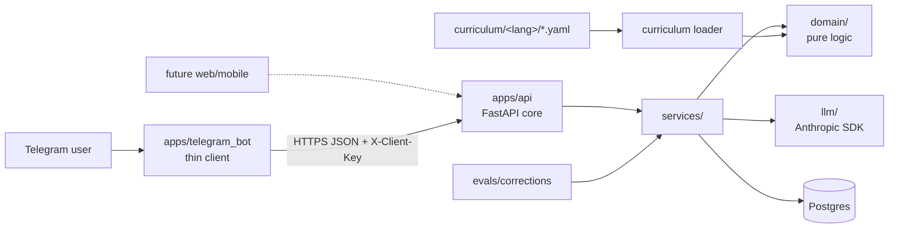

# Architecture

Status: Phase 1 scaffolded, 2026-11-24. This is the source of truth for structure. Change it in the same commit as any structural change.

## 1. Goals and non-goals
**Goals**
- A conversational tutor that corrects the learner at the right depth for their CEFR level (A1–C2).
- A learner model that improves over time:
  - mastery per grammar topic
  - mastery per word
  - a level per skill (speaking, listening, reading, writing, grammar, vocab)
- One core API that every client uses. Telegram is first; web and mobile come later.
- Adding a language means adding data (`curriculum/<lang>/`), not code.
- Measurable correction quality through an eval set.

**Non-goals for Phase 1:**
- voice
- web or mobile UI
- spaced-repetition scheduling
- placement testing
- real user auth or billing
- content for languages other than Spanish

## 2. Components

Layering inside `apps/api`. Arrows mean "may import":
`routes → services → (domain, llm, db, curriculum)`. `domain` imports nothing that does I/O.

| Layer | Responsibility |
|---|---|
| routes | HTTP, auth header, DTO in/out (from `packages/contracts`). No logic. |
| services | Use-case orchestration and transaction boundaries (`turn_service`, `session_service`, `learner_service`). |
| domain | Level policy resolution, prompt assembly, mastery/skill math, tag sanitising. Pure and fully unit-tested. |
| llm | One wrapper around the Anthropic client: model id from config, structured output parsing, refusal/fallback handling, token accounting. |
| curriculum | Loads and validates YAML at startup into an immutable in-memory `Curriculum` object per language. |
| db | SQLAlchemy 2 async models and repositories. |

**Running it day to day (single Windows machine).** `scripts/supervisor.py` (stdlib only) runs the
API (uvicorn, no `--reload`, 127.0.0.1:8000) and the bot as windowless child processes. It restarts
a child that exits, with exponential backoff (2s up to 5 min, reset after 60s of healthy running),
writes `logs/{api,bot,supervisor}.log` (rotated at 5 MB) and keeps its pid and state in `.run/`.
`tutor.cmd` → `scripts/tutor.py` gives `start | stop | restart | status | logs | autostart on|off`.
Autostart is a shortcut in the user's Startup folder (no admin, no Windows service). It refuses to start
if port 8000 is already served, and Telegram allows only one poller, so never run a manual bot alongside
it. This is a local convenience, not the production deployment.

## 3. Curriculum data (YAML)
Ids are global, stable and namespaced: `<lang>.<level>.<slug>`. **Never rename an id once it is used.** Mark it `deprecated: true` instead.

`curriculum/es/grammar/a1.yaml`
```yaml
- id: es.a1.ser_vs_estar_basic
  level: A1
  title: "Ser vs estar (identity vs location/state)"
  prerequisites: [es.a1.present_regular]
  description: "Ser for identity/origin/profession; estar for location and temporary states."
  examples:
    - { wrong: "Yo soy en Madrid.", right: "Yo estoy en Madrid." }
```

`curriculum/es/scenarios/a2.yaml`
```yaml
- id: es.a2.restaurant_order
  level: A2
  title: "Ordering at a restaurant"
  setting: "A small tapas bar in Sevilla, evening."
  bot_role: "Friendly waiter who speaks only Spanish."
  goals: ["Order food and drink", "Ask for the bill"]
  target_topics: [es.a2.quisiera_conditional_polite, es.a1.gender_agreement]
  key_vocab: [la cuenta, la ración, para picar]
  opening_line: "¡Buenas noches! ¿Qué les pongo?"
```

`curriculum/es/levels.yaml` holds the level policy that drives adaptation:
```yaml
A1:
  rank: 1                           # orders the levels; code never hard-codes level names
  explanation_language: native      # native | mixed | target
  max_corrections_per_turn: 2
  correct_topics: at_or_below_level # at_or_below_level | all | all_plus_style
  tutor_reply: { max_sentences: 2, vocab_ceiling: A1, speed_note: "very simple, present tense" }
  free_opening: "¡Hola! ¿Cómo estás?"   # tutor's first line in a session with no scenario
  label: "Total beginner"              # learner-facing, plain words (no CEFR jargon)
  can_do: "I know a few words, or none at all"
  starter_scenario: es.a1.meet_new_friend  # first role-play after onboarding (must be at this level)
B1:
  rank: 3
  explanation_language: mixed
  max_corrections_per_turn: 4
  correct_topics: all
  tutor_reply: { max_sentences: 4, vocab_ceiling: B1 }
  free_opening: "..."
```
Every level A1–C2 is defined. A new profile starts at the lowest-ranked level.

`curriculum/es/language.yaml` holds everything else language-specific that code needs, so code stays language-agnostic:
```yaml
code: es
name: Spanish
native_name: Español
refusal_reply: "Perdona, no puedo responder a eso. ¿Seguimos con otra cosa?"
prompt_notes:      # appended to the tutor system prompt (e.g. "don't flag a missing ¿")
  - "..."
```

The loader fails startup on any of these:
- a duplicate id
- an unknown prerequisite
- a prerequisite cycle
- a prerequisite at a higher level than its dependent
- a scenario `target_topics` entry that doesn't exist
- a missing level in `levels.yaml`
- an id whose prefix doesn't match its language and level (`es.a1.` for an A1 Spanish topic)
- duplicate level ranks, or a `vocab_ceiling` that isn't a defined level
- unknown fields, or YAML syntax errors

## 4. Data model (Postgres)
| table | columns (PK **bold**) | notes |
|---|---|---|
| users | **id uuid**, display_name, created_at | one per human |
| user_identities | **provider, external_id**, user_id | `provider` ∈ telegram/web/…; lets one human use many clients |
| learner_profiles | **id uuid**, user_id, target_lang, native_lang, explanation_lang_override?, cefr_level, created_at, timezone?, daily_goal?, reminders_enabled, last_reminded_on?, streak_best | unique(user_id, target_lang): one profile per language learned. NULL timezone / daily_goal mean the configured default (`DEFAULT_TIMEZONE`, `DEFAULT_DAILY_GOAL`) |
| lesson_runs | **id**, profile_id, topic_id, explanation, exercises jsonb, answers jsonb, correct, llm_model, created_at, finished_at? | one grammar lesson as shown to the learner. Answers are graded against the stored exercises, in order |
| review_items | **id**, profile_id, source_text, wrong, right, rule_tag, explanation, box, due_at, reviews, lapses, last_reviewed_at?, created_at | spaced-repetition card per distinct mistake; unique(profile_id, wrong, right), index(profile_id, due_at). Created by turns; migration 0003 backfilled existing mistakes |
| daily_activity | **profile_id, day**, messages | learner messages per *local* day (learner's timezone); drives streaks and the daily goal |
| skill_levels | **profile_id, skill**, cefr_level, score (0–1), updated_at | skill ∈ speaking, listening, reading, writing, grammar, vocab |
| grammar_mastery | **profile_id, topic_id**, mastery (0–1), attempts, errors, last_seen_at | topic_id = curriculum id (text) |
| vocab_items | **id**, profile_id, lemma, translation, pos, seen_count, mastery, first_seen_at, last_seen_at | unique(profile_id, lemma) |
| sessions | **id uuid**, profile_id, mode (free/roleplay), scenario_id?, level_at_start, started_at, ended_at? | at most one open session per profile |
| turns | **id**, session_id, seq, role (learner/tutor), text, grammar_tags text[], llm_model, result_json jsonb, input_tokens, output_tokens, created_at | unique(session_id, seq). The opening line is tutor turn seq 0. On tutor turns `result_json` = `{raw, final, shown, refused, refusal_category, unknown_tags, policy_violations, cache_*_tokens}`: the raw model TurnResult is kept for audit/re-scoring |
| mistakes | **id**, profile_id, turn_id, wrong, right, rule_tag, explanation, severity, created_at | index(profile_id, rule_tag), index(profile_id, created_at) |

Curriculum ids are stored as text, not as FKs. The YAML is the authority, and startup validation keeps the data consistent.

## 5. API (v1)
All JSON. Every `/v1` call sends `X-Client-Key`, which is checked against `CLIENT_API_KEYS` (the API refuses to start if that is empty; `/healthz` is open). Service errors map to 404 / 409 (session ended) / 400 / 502 (LLM failure). DTOs live in `packages/contracts`.

| method | path | purpose |
|---|---|---|
| GET | /healthz | liveness + curriculum loaded |
| POST | /v1/users/resolve | `{provider, external_id, display_name, target_lang, native_lang}` → user + profile (idempotent) |
| GET / PATCH | /v1/learners/{profile_id} | profile, skill levels, settings (level, native language, explanation language, timezone, daily goal, reminders). Omitted PATCH fields are unchanged; `explanation_lang_override: null` / `timezone: null` reset to the default |
| POST | /v1/learners/{id}/ask | `{question, turn_id?}` → `{question, answer}` (with `turn_id`, that tutor message is the subject): a side question answered with the open conversation as context; not stored as a turn, not corrected, not counted as practice |
| GET | /v1/learners/{id}/lessons | `{suggested[], level_topics[]}`: topics with mastery, lessons taken and reason (`weak`/`next`/`refresh`) |
| POST | /v1/learners/{id}/lessons | `{topic_id}` → `{id, topic, explanation, exercise}`: generates a lesson (one model call, `LESSON_EFFORT`) |
| POST | /v1/lessons/{id}/answer | `{index, answer}` → `{correct, expected, why, feedback?, score, answered, total, next?, mastery, progress}`; 409 if already answered |
| GET | /v1/learners/{id}/review/next | `{card?, due, total, next_due_at?}`: next mistake card due (the correct form is not sent) |
| POST | /v1/review/{card_id}/answer | `{answer}` → `{correct, wrong, right, explanation, feedback?, next_review_in_days, due, progress}` |
| GET | /v1/learners/{id}/progress | `{streak, best_streak, today, goal, goal_met}` |
| GET | /v1/learners/{id}/mistakes?topic=&limit= | recent mistakes |
| GET | /v1/learners/{id}/vocab?limit= | vocab |
| GET | /v1/learners/{id}/active-session | open session or 404 (clients stay stateless) |
| GET | /v1/curriculum/{lang} | language name + levels with `label`, `can_do`, `starter_scenario` (onboarding screens) |
| GET | /v1/curriculum/{lang}/levels | level codes in rank order (clients never hard-code levels) |
| GET | /v1/curriculum/{lang}/grammar?level= | topics (exactly at `level` if given) |
| GET | /v1/curriculum/{lang}/scenarios?level= | scenarios within one level of `level` (all if omitted) |
| POST | /v1/sessions | `{profile_id, scenario_id?}` → session + tutor opening line + `opening_turn_id` (closes any open session) |
| POST | /v1/sessions/{id}/turns | `{text}` → `TurnResponse` = `TurnResult` + `turn_id` + `well_done[]` + `progress` (streak/goal after this message, with `first_today` and `goal_just_met`) |
| POST | /v1/reminders/claim | `{provider, target_lang}` → learners of that client due a practice reminder now; each is marked reminded for their local day |
| POST | /v1/sessions/{id}/turns/voice | multipart `audio` (any common format; Telegram OGG/Opus) → `TurnResponse` with `transcript`. 503 if STT is disabled, 400 if no speech or longer than `STT_MAX_SECONDS` |
| POST | /v1/turns/{turn_id}/help | `{kind: hint\|translate\|suggest\|explain}` on a **tutor** turn → `{kind, text}` |
| POST | /v1/sessions/{id}/end | close session → summary (turn count, top mistakes, new vocab) |

## 6. A conversation turn
```mermaid
sequenceDiagram
  participant B as Telegram bot
  participant A as API /turns
  participant S as turn_service
  participant D as domain
  participant L as llm (Anthropic)
  participant P as Postgres
  B->>A: POST /v1/sessions/{id}/turns {text}
  A->>S: handle_turn(session_id, text)
  S->>P: load profile, mastery summary, recent turns (short read; no tx held during the LLM call)
  S->>D: resolve_policy(level, levels.yaml) + build_prompt(policy, scenario, profile)
  S->>L: beta.messages.parse(model=TUTOR_MODEL, output_format=TurnResult, fallbacks)
  L-->>S: TurnResult (validated) | refusal
  S->>D: sanitize_tags + apply_policy (safety net) + topic_updates
  S->>P: insert turns, mistakes, upsert vocab_items, grammar_mastery (one tx)
  S-->>A: TurnResult
  A-->>B: JSON → bot formats reply + corrections
```

**TurnResult schema**, the contract with the LLM (any change means re-running the eval). The API returns it wrapped as `TurnResponse`, adding fields the server computes (the LLM never sees them):
- `turn_id`: the tutor turn, for help requests
- `well_done[]`: `{id, title}` of topics used correctly, from `domain/tags.py::well_done_topics`. That is the grammar tags minus every corrected topic (including corrections beyond the display cut), at most 2.

Mistakes and session summaries also carry readable topic titles (`rule_title`, `title`).

```
TurnResult {
  reply: str                          # tutor's in-character response, at the learner's level
  corrections: [ { wrong: str, right: str, rule_tag: topic_id|"unknown",
                   explanation: str,  # in the policy's explanation language
                   severity: "minor"|"major" } ]
  new_vocab:   [ { lemma: str, translation: str, pos: str, example: str } ]
  grammar_tags: [topic_id]            # topics the learner's message exercised
}
```

**LLM call rules**
- Structured outputs: `client.beta.messages.parse(output_format=TurnResult)` (the beta surface carries server-side `fallbacks`). Thinking is adaptive.
- The LLM-plus-domain path is `turn_service.run_correction` (no DB). `handle_turn` and the eval both call it.
- No assistant prefill and no forced `tool_choice`. Current models reject both.
- The model comes from `TUTOR_MODEL` (default `claude-opus-5-5`), with `effort` set explicitly. Change models only on eval evidence. Turns run at `TUTOR_EFFORT=low`: on the correction eval it matched `medium` on every case at about half the cost and a shorter latency tail. Help buttons use `TUTOR_HELP_EFFORT` (also `low`).
- **Per-language routing** (`TUTOR_LANG_OVERRIDES`, JSON): conversation turns for a language can use another model and effort. The eval uses the same route (`run_eval.py --lang` reads it; `--model`/`--effort`/`--fallbacks` override). Help, ask, grading and lessons stay on `TUTOR_MODEL`, because no eval covers them yet. Decision (2026-11-25, correction eval, 56 cases; per-language results below; Sonnet 5.5 at low made two corrections that were themselves wrong):

  | Model | es (34) | zh (11) | ja (11) | Wrong corrections | Cost, 56 cases |
  |---|---|---|---|---|---|
  | Opus 5.5, low | 34/34 | 11/11 | 11/11 | 0 | ~$0.75 |
  | Haiku 5.5, medium | 34/34 | 10/11 | 8/11 | 0 | ~$0.03 |

  Repeat runs showed Haiku weaker at B1 (62-75% recall), so the route has `"levels": ["A1","A2"]`: es and zh A1-A2 turns use `claude-haiku-5-5` at `medium` (fallbacks off: Haiku has no server-side refusal fallback); B1+ and all ja turns use Opus. With that routing (`run_eval.py` picks the model per level, like production): es and zh 1.00 recall and precision at every level.
- **Helper model** (`TUTOR_HELP_MODEL`, `TUTOR_HELP_FALLBACKS`): hint, translate, suggest, explain, ask and answer checking run on `claude-haiku-5-5` (about $0.0001 per call). No eval covers these; they were spot-checked live. Lessons stay on `TUTOR_MODEL` at `LESSON_EFFORT`, because exercise correctness matters. Side answers follow the level's explanation language (`_ASK_LANGUAGE`), not the language of words quoted in the question.
- **Usage visibility**: turns keep their tokens on the tutor turn row; every other model call is logged to `llm_calls` (kind, lang, model, tokens). `tutor usage [-d N]` prints calls, tokens and estimated cost by kind, language and model (`scripts/usage_report.py`, prices from the Pricing page).
- Check `stop_reason`. On `refusal`, return a polite generic reply with no corrections and log it. Server-side fallbacks are enabled (`fallbacks: "default"`, `TUTOR_FALLBACKS=off` disables them). The refusal reply text comes from `language.yaml`.
- Prompt order for caching:
  1. tutor instructions + level policy + topic catalogue for the level (stable, cached)
  2. scenario
  3. learner summary
  4. recent turns
  5. the new message

  Item 1 is the `system` block with `cache_control`. Items 2–5 go in a single user message as tagged sections (`<scenario>`, `<learner>`, `<conversation>`, `<latest_learner_message>`), with learner text XML-escaped. The learner's native language goes in `<learner>`, not the system prompt, so learners at the same level share the cache.
- After the call, `domain/tags.py::apply_policy` enforces the policy as a safety net: it drops above-level corrections at `at_or_below_level` and no-op corrections (each logged and stored as a policy violation), and orders major before minor.
- **All errors vs. what is shown.** The model reports *every* in-scope error. `max_corrections_per_turn` is a display limit only: `for_display` cuts the list for the learner (`TurnResponse.corrections`, stored as `result_json.shown`), while the full list (`result_json.final`) drives mistakes, mastery and praise. Before this split, the model was told "at most N", so hidden errors were silently dropped and their topics in `grammar_tags` counted as correct uses, raising mastery on a mistake. A sanity ceiling (`MAX_REPORTED_CORRECTIONS`) guards against runaway output.
- Ask the model to list the learner's correct uses as `grammar_tags`, so mastery can go up as well as down.

**Learner help** (`services/help_service.py`, prompt in `domain/prompt.py::build_help_prompt`) runs on a tutor turn, including the opening line:
- `hint`: what the tutor asked plus a few useful words, without the answer (native language)
- `translate`: the tutor message in the native language
- `suggest`: one example answer at the learner's level, with a translation
- `explain`: a deeper explanation of that turn's corrections, in the policy's explanation language

It uses the same model with `TUTOR_HELP_EFFORT` (default `low`, measured at 2–5 s), structured output `{text}`, and no prompt caching (the prompt is short and per-learner). Help requests are not persisted.

## 7. Level adaptation
`domain/policy.py` merges three inputs:
1. the `levels.yaml` entry for the learner's `cefr_level`
2. the profile override (`explanation_lang_override`)
3. the scenario

The result is a `Policy` object, and prompt assembly reads only that object:

| Policy field | What it controls |
|---|---|
| `explanation_language` | language of `explanation` text: native → learner's `native_lang`, target → the target language, mixed → target language with native glosses |
| `max_corrections_per_turn` + `correct_topics` | how many corrections the learner is shown (all are recorded); at low levels, errors above the learner's level are ignored, not flagged |
| `tutor_reply` | length and vocabulary ceiling of the tutor's reply |

## 8. Learner model updates (`domain/mastery.py`)
- **Per topic.** Uses an exponentially weighted update with α from config:
  - correct use: `m ← m + α(1−m)`
  - error: `m ← m − α·m·w`, where w is 1.0 for major and 0.5 for minor
  - `attempts` and `errors` are counted alongside.
- **Per word.** `seen_count++` when the tutor introduces it (`new_vocab`) and when the learner uses it. Mastery rises (`m ← m + α(1−m)`) only when the learner's message contains a known lemma outside any corrected span.
- Topics start at mastery 0. Each correction is one error on its `rule_tag`. A `grammar_tag` with no correction on the same topic is one correct use. `unknown` is never tracked.
- **Skill levels.** These change only from aggregates, never on a single turn. Phase 1 updates only the `grammar` and `vocab` scores, at session end, as the mean mastery of practised topics and known words. A learner-confirmed level change (PATCH) moves every skill's `cefr_level` with it. CEFR level changes are proposed by the system and confirmed by the learner, not applied automatically.

## 8b. Practise my mistakes (`domain/review.py`, `services/review_service.py`)
- Every correction in a turn upserts a card keyed by (profile, wrong, right), holding the learner's original message. Repeating a known mistake in chat sends its card back to box 0.
- Leitner boxes: a new or failed card is due again after 10 minutes. A correct answer moves it up one box, with intervals of 1, 3, 7, 16 and 35 days.
- The learner sees their original sentence with the error underlined and replies with a fix. `quick_grade` accepts an answer that contains the stored fix and not the error, for free. Anything else is judged by the model (`build_grade_prompt`, `ReviewGrade` structured output, help effort), which accepts correct alternatives and gives feedback in the explanation language.
- Each review answer counts toward the daily goal and streak. Reminders mention the number of cards due.

## 8c. Grammar lessons (`domain/lessons.py`, `services/lesson_service.py`)
- **Suggestions** (pure, from mastery and curriculum order): up to 3 *weak* topics (practised, mastery < 0.6, most errors first), then *next* topics at the learner's level that are not practised yet and whose prerequisites are, in YAML order, then *refresh* (lowest mastery) to fill the list.
- **A lesson** is one structured-output call (`LessonContent`: lesson parts + exercises of kinds `fill_blank` / `fix` / `translate`, each with `answer`, `also_accept` and `why`). The parts are `summary`, `forms` (label + items joined with " · "), `usage` bullets, 3 `examples` (sentence + translation in the native language) and `watch_out` (wrong, right, note). They are stored in `lesson_runs.parts` (migration 0006) and returned as `LessonOut.parts`, with `explanation` as a plain-text rendering. The bot lays them out with headings, monospace forms and ❌/✅. It uses the topic's YAML (title, description, examples) and the learner's own past mistakes on it. The explanation follows the level's explanation language. `LESSON_EXERCISES` (5) exercises, at `LESSON_EFFORT` (medium: exercise correctness matters). The run is stored, so grading uses exactly what was shown.
- **Answers**: an exact normalised match against `answer`/`also_accept` is free. Otherwise the model judges (`build_exercise_grade_prompt`, `ReviewGrade`). Each answer is one attempt on the topic's mastery (an error counts as major) and counts toward the daily goal.
- **Telegram**: 📖 Grammar lessons (or `/lessons`) shows suggestions (🎯 weak, 🆕 next, 🔁 refresh) plus "All topics at my level" (`ls:<topic_id>`, `lb`). The explanation is followed by exercises as reply prompts headed `📝 Lesson #<id> · n/N`. The reply quotes that header, so routing is stateless. Each result message carries the next question. At the end: "Use it in a conversation", "Another lesson", "My mistakes".

## 9. Evaluation (`evals/corrections`)
`cases/<level>.yaml`:
```yaml
- id: a1-001
  level: A1
  text: "Yo soy en la playa con mi amigos."
  expected:
    - { wrong: "soy en", right: "estoy en", rule_tag: es.a1.ser_vs_estar_basic }
    - { wrong: "mi amigos", right: "mis amigos", rule_tag: es.a1.possessive_agreement }
  must_not_flag: ["la playa"]
```
`run_eval.py` runs each case through the same `turn_service` correction path with a fixed neutral session context. For each level it reports:
- correction recall and precision. A match means the normalized `right` text matches and the span overlaps.
- rule_tag accuracy
- false positives on `must_not_flag`
- level-policy violations (interventions by `apply_policy`: too many corrections, above-level corrections, no-ops). Checking the explanation language automatically is not implemented yet.
- refusals and errors
- tokens and cost

Scoring lives in `evals/corrections/scoring.py` (pure, unit-tested). Prices are CLI flags (`--input-price`, `--output-price`). It writes a dated JSON report under `evals/corrections/reports/`. It makes real API calls, so run it on purpose. Start with about 30 cases across A1–B2 and grow the set whenever a bad correction shows up in real use.

## 10. Telegram client (`apps/telegram_bot`)
Button-first, so nobody needs to type commands. Modules:
- `bot.py`: handlers
- `keyboards.py`: menus and callback data
- `formatting.py`: DTO → HTML
- `api_client.py`: HTTP

**Onboarding** (first `/start`) runs in three steps:
1. "Which language should I explain things in?" (buttons, with Telegram's language first)
2. "How much Spanish do you know?" (buttons with `label` · `can_do` from `levels.yaml`)
3. The main menu appears and the learner is dropped straight into the level's `starter_scenario`.

**Persistent menu** under the text box: 💬 Free chat · 🎭 Role-play · 📊 My progress · 🏁 Finish session · ⚙️ Settings · ❓ How it works. Commands still exist for power users and are registered with `setMyCommands` so `/` shows a menu:
- `/start`, `/chat`, `/roleplay`, `/progress`, `/end`, `/settings`, `/help`
- older aliases: `/play <id>`, `/level [code]`, `/native [code]`, `/scenarios`, `/mistakes`

**Every tutor message** (including opening lines) carries 💡 Hint · 🌐 Translate · ✍️ Suggest, and 🙋 Ask, plus ❓ Explain my mistakes when there were corrections.

**🙋 Ask about one message.** Tapping it sends a reply prompt attached to that tutor message. The prompt holds `?start=ask_<turn_id>_<message_id>` in an invisible text link, which Telegram passes back with the learner's reply, so routing needs no bot state. The bot calls `/ask` with `turn_id`: that tutor message becomes `<message_in_question>`, and the history before it is context. It then edits the tutor message to append the Q&A in a collapsed blockquote (keeping its buttons) and deletes the prompt and the question message. The tutor message's HTML is cached in `chat_data` when Ask is tapped (last 50 per chat). If the cache is gone (bot restarted) or the 4096-character limit would be exceeded, the answer is sent as a reply under the tutor message instead.

**Turn message layout (foldable).** By default a tutor message shows only the reply (plus "🎤 I heard…" for voice and the rare 🔥/🎯 milestone line). The feedback (✅ praise, ✏️ fixes with a collapsed "Why", 📚 new words) is folded behind a toggle button labelled with what's inside, e.g. `▾ ✏️ 2 fixes · 📚 1 word` (`fb:<turn_id>`). "Explain my mistakes" appears once the fixes are unfolded. Hint, Translate, Suggest, Explain and 🙋 Ask answers are added inside the same message as collapsed blockquotes (each help kind once per message) instead of separate messages.

How it works: `views.py` keeps a small dict per tutor message (`body`, `feedback`, `label`, `expanded`, `extras`) in `chat_data`, at most 100 per chat. Every button re-renders the message from it with `editMessageText`. `chat_data` is persisted with `PicklePersistence` to `BOT_STATE_FILE` (default `.run/bot_state.pickle`; display state only, never learner data), so folding survives restarts. A message with no view, or one that would exceed 4096 characters, falls back to sending the help as a reply.

The bot keeps sending "typing…" until the API answers. After 🏁 Finish, it offers next-step buttons.

**Stateless:** each step's choice travels in callback data (`h:<kind>:<turn_id>`, `ask:<turn_id>`, `nat:<code>:<o|s>`, `lvl:<code>:<o|s>`, `play:<id>`, `goal:<n>`, `rem:<on|off>`, `menu:<action>`, all ≤ 64 bytes). The active session comes from the API.

**Config:**
- `TELEGRAM_TOKEN`, `TUTOR_API_URL`
- `TUTOR_API_KEY` (defaults to the first `CLIENT_API_KEYS` entry)
- `BOT_TARGET_LANG`
- `BOT_NATIVE_LANG_CHOICES` (`code:label` list for the language buttons)

**Voice messages.** Voice notes and audio files are downloaded by the bot and posted to `/turns/voice`. The reply starts with "🎤 I heard: …" so the learner can see what the corrections are based on.

**Speech-to-text (`apps/api/src/tutor_api/stt/`).** Local faster-whisper (`STT_MODEL`, default `small`, CPU int8), the only package allowed to import it (guarded by a test). The model lives in `STT_MODEL_DIR` (default `<repo>/.models/whisper`, gitignored, about 460 MB) and is loaded in the background at startup. Audio is decoded with PyAV to 16 kHz mono, then transcribed in the learner's target language with VAD, one transcription at a time. The transcript then goes through the normal turn path. Caveat: Whisper can smooth over small grammar slips, so spoken turns may get fewer corrections than typed ones.

**Side questions.** 🙋 Ask (a reply prompt), `/ask <question>`, or any message starting with `?` goes to `POST /v1/learners/{id}/ask` instead of the conversation. Messages starting with Spanish `¿` stay in the conversation. The answer comes in the language of the question.

**Practise mistakes.** 🧠 Practise mistakes (or `/review`) shows the next card as a reply prompt headed `🧠 Practice #<card id>`. The learner's reply quotes that header, so the bot can route the answer to `POST /v1/review/{id}/answer` without keeping state. After each answer: ▶️ Next (`rv:next`) or 🏁 Stop (`rv:done`).

**Habits (streaks, daily goal, reminders).** The API owns all of it (`domain/streaks.py` is pure, `services/habits_service.py` does the I/O); the bot only renders it.
- Every learner message adds one to today's `daily_activity` row, using the learner's local day. The streak is the run of consecutive active days ending today or yesterday (today is not over yet).
- After a turn, the bot adds one line only on the first message of the day (🔥 streak) or when the goal is reached (🎯), so ordinary turns stay clean. 📊 My progress shows the streak, best streak and today's goal bar. ⚙️ Settings changes the goal (`goal:<n>`) and toggles reminders (`rem:on|off`).
- Reminders: the bot polls `POST /v1/reminders/claim` every `BOT_REMINDER_POLL_SECONDS` (300). The API returns learners whose local time is past `REMINDER_HOUR`, who have not practised today, who practised within `REMINDER_MAX_IDLE_DAYS`, and who have not been reminded today, and marks them reminded. A learner who blocked the bot gets reminders switched off.

**Languages.** The bot offers `BOT_TARGET_LANGS` (default `es,zh,ja`). The chat's current language lives in `chat_data["lang"]` (display state, persisted). It is picked on first `/start` (`tl:<code>:o`) and switched in ⚙️ Settings or `/language` (`tl:<code>:s`); before a pick, the default is `BOT_TARGET_LANG`. Every API call resolves the profile for that language, so level, mistakes, cards, lessons and streak are kept per language. Switching to a new language keeps the explanation language and asks the level, then starts the level's starter role-play. Reminders are claimed per language, tagged with the flag and name, and their buttons (`go:<code>:resume|review`) switch to that language first.

## 10b. Chinese and Japanese
- **Same CEFR scale** (A1–C2) for every language, so no code knows level names. Labels show the familiar equivalent ("≈ HSK 1", "≈ JLPT N5").
- **Reading aids** are level policy, not code. `tutor_reply.speed_note` asks for pinyin (zh, A1–A2) or hiragana readings after kanji (ja, A1–A2), and fewer at B1. `prompt_notes` set the conventions: Simplified characters, accept pinyin/romaji/kana input, the particle focus for Japanese, and `new_vocab.translation` starting with the reading.
- **Text matching** (`domain/text.py`): Chinese and Japanese have no spaces between words, so phrases match as substrings there and on word boundaries elsewhere. Used by vocab mastery, review quick-grading and eval scoring.
- **Speech-to-text**: `language.yaml` `stt_prompt` steers Whisper (Simplified characters for zh).
- **Eval**: `evals/corrections/cases/<lang>/`. First run (effort low): zh and ja A1–B1, 11 cases each, recall/precision/tag accuracy 1.00.

## 11. Extensibility
- **New language:** add `curriculum/<lang>/` with `language.yaml` (incl. `flag`, optional `stt_prompt`), `levels.yaml`, grammar and scenarios, add eval cases in `evals/corrections/cases/<lang>/`, and add the code to `BOT_TARGET_LANGS`. No code change is needed. The code takes `lang` as a parameter everywhere.
- **New client (web, mobile, voice):** a new `apps/<client>` that uses `packages/contracts` and calls the API.
- **Multi-user:** already modelled (`users`, `user_identities`). Real auth (per-user tokens) replaces `X-Client-Key` later.
- **Different model per route** (e.g. a cheaper model for summaries): add config keys. The `llm/` wrapper is the only place that changes.

## 12. Roadmap after Phase 1
- spaced-repetition review of vocab (mistakes: done, section 8b)
- placement test
- voice: speech-to-text in, text-to-speech out, plus speaking and listening skill updates
- web client
- per-user auth
- reading and writing exercises

## 13. Layering guards
`apps/api/tests/test_architecture.py` enforces the rules mechanically:
- the bot never imports `tutor_api`, `anthropic` or `sqlalchemy`
- `domain/` imports nothing that does I/O
- only `llm/` imports `anthropic`
- routes don't import `db`, `llm` or `domain`
- there are no `claude-*` model literals outside `config.py`
- there are no CEFR level literals in API code

Tests use an in-memory SQLite DB (Postgres types have SQLite variants) and a fake `TurnLLM`. Migrations target Postgres only.
